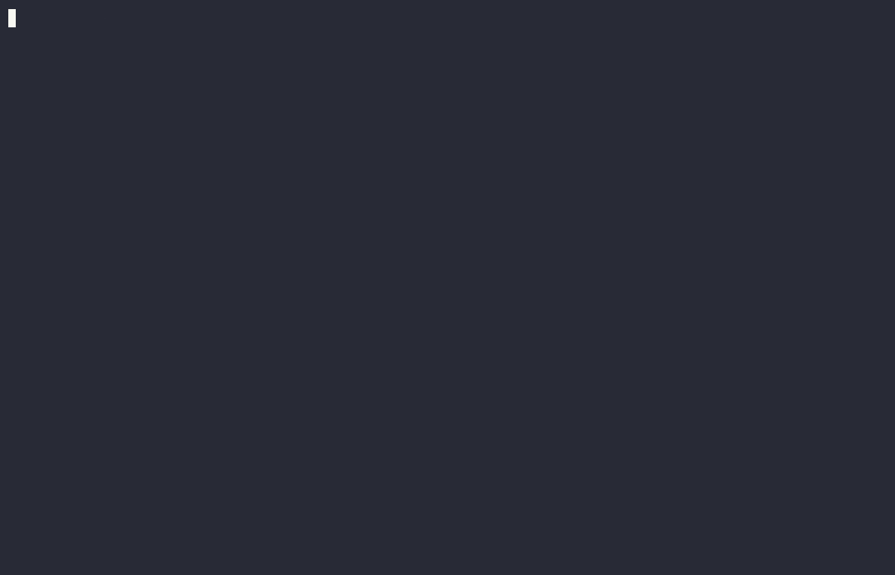

# CQ - Python Code Quality Analysis Tool

[](https://github.com/rhiza-fr/py-cq/actions/workflows/ci.yml)
[](https://codecov.io/gh/rhiza-fr/py-cq)
[](https://pypi.org/project/python-code-quality/)
[](https://pypi.org/project/python-code-quality/)
[](LICENSE)

`cq` runs 14 code quality tools on a Python project, combines their results into one score, and shows the single most important defect as a short markdown prompt you can hand to an LLM.

Fix that one issue, run `cq` again, and repeat until everything passes. Neither you nor the LLM has to know how to run or read the individual tools.

`cq` never edits your files. You may want to run `ruff check --fix` and `ruff format` first so the easy fixes are already done.



## Install

Requires Python 3.12+ and [uv](https://docs.astral.sh/uv/).

```bash
# install the `cq` command line tool from PyPI
uv tool install python-code-quality

# optional: secret scanning (see Tools below)
uv tool install kingfisher-bin
```

`ty`, `pytest` and `coverage` run inside your project's own environment with `uv run`, so they see your dependencies. If your project does not include them, `uv` adds them for that run only; your project files are not changed.

To install from source instead:

```bash
git clone https://github.com/rhiza-fr/py-cq.git
cd py-cq
uv tool install .
```

## Quick start

From your project's root directory:

```bash
cq check .            # table overview of all scores
cq check . -o llm     # top defect as markdown, to pipe to an LLM
cq check . -o score   # numeric score only, exits 1 on errors (CI gate)
```

`cq check . -o llm` prints one issue with the code around it, for example:

````
shop.py:6 - F821: Undefined name `discount`
```python
3: 
4: def total(prices: list[float]) -> float:
5:     """Return the sum of prices."""
6:     return sum(prices) + discount
7: 
8: 
```

`discount` is not imported or defined anywhere else in this file.

Enclosing function:
```python
4: def total(prices: list[float]) -> float:
5:     """Return the sum of prices."""
6:     return sum(prices) + discount
```

Please fix only this issue.
````

To send it straight to an LLM: `cq check . -o llm | claude -p "fix this"`.

## Usage

```bash
cq check .                 # Table overview of scores for humans
cq check . -o llm          # Top defect as markdown for LLMs
cq check . -o llm-json     # Top defect as JSON with fingerprint (for automation)
cq check . -o score        # Numeric score only for CI
cq check . -o json         # Detailed parsed JSON output for jq
cq check . -o raw          # Raw tool output for debug
cq check path/to/file.py   # Just one file (skips pytest and coverage)
cq check . --only ruff,ty  # Run only specific tools
cq check . --skip bandit   # Skip specific tools
cq check . --exclude demo  # Exclude paths from all tools
cq check . -o llm --limit 3              # Show the top 3 issues instead of 1
cq check . -o llm -s src/foo.py:42:E501  # Silence one issue (or a whole file: -s src/foo.py)
cq check . -o llm --order phase          # Fix in tool order (syntax, lint, types, ...) instead of most severe first
cq check . -o llm --hint   # Append "run cq again to verify" (for human workflows)
cq check . --workers 1     # Run sequentially if you like things slow
cq check . --clear-cache   # Clear cached results before running (rarely needed)
cq config                  # Show the effective tools and thresholds for this project
cq is-fixed <fingerprint>  # Check whether a specific issue has been resolved
```

**Exit codes:** `cq check` exits with code `1` if any tool metric falls below its `error_threshold`, so it works as a CI gate:

```bash
cq check . && deploy        # block deploy on errors
cq check . -o score         # print score, exit 1 on errors
```

## Tools

| Order | Tool | Measures |
|----------|------|----------|
| 1 | compileall | Syntax errors |
| 2 | ruff | Lint / style |
| 3 | ty | Type errors |
| 4 | bandit | Security vulnerabilities |
| 5 | kingfisher | Hardcoded secrets (API keys, tokens, private keys) |
| 6 | uv audit | Known vulnerabilities in locked dependencies |
| 7 | pytest | Test pass rate |
| 8 | coverage | Test coverage |
| 9 | vulture | Dead code |
| 10 | interrogate | Docstring coverage |
| 11 | radon cc | Cyclomatic complexity |
| 12 | radon mi | Maintainability index |
| 13 | radon hal | Halstead volume / bug estimate |
| 14 | ruff format | Formatting (fraction of files already formatted) |

By default all tools run in parallel. With `-o llm`, tools run in this order and `cq` stops at the first tool that fails, since later results are not needed to pick the top issue. `coverage` starts alongside `pytest` and is cancelled if `pytest` fails, scoring `0%` without a second test run.

Tool output is cached with diskcache, so re-runs on unchanged files are fast. The cache stays under 100 MB, keeps entries for up to 5 days, and is stored as JSON (cq never writes pickles).

### Notes on specific tools

`kingfisher` scans the working tree for hardcoded secrets with [Kingfisher](https://github.com/mongodb/kingfisher) (502 rules, Rust). It is not a Python dependency of cq: install it once with `uv tool install kingfisher-bin` (about 41 MB). When it is not on the `PATH` the tool is skipped with a warning. cq runs it offline (`--no-validate --no-update-check`) and with `--redact`, so secrets are never sent to provider APIs and never stored in the cache; the LLM message gives the file, line and rule but no source excerpt. Silence a test fixture or false positive with a `kingfisher:ignore` comment on that line.

`uv audit` checks the versions pinned in `uv.lock` against the OSV advisory database. It needs `uv` on the `PATH`, a `uv.lock` and network access; when any is missing the tool is skipped with a warning instead of failing. Only advisories that have a fix version are reported, since those are the ones an upgrade resolves. Results are cached like every other tool, so an advisory published after a run shows up when the project changes or the cache entry expires.

`vulture` runs at `--min-confidence 60`, the level at which it reports unused functions, classes, methods and variables. It cannot see dynamic use, so common framework decorators (`@app.command`, `@app.route`, `@pytest.fixture`, validators and similar) are ignored. For anything else that is used but never referenced by name, such as public API, add it to `ignore_names` under `[tool.vulture]` in your `pyproject.toml`.

## Configuration

Add a `[tool.cq]` section to your project's `pyproject.toml`:

```toml
[tool.cq]
# Skip tools that are slow or not relevant to your project
disable = ["coverage", "interrogate"]

# Exclude paths from all tools (merged with --exclude CLI flag)
exclude = ["demo", "docs"]

# Lines of source context shown around each defect in LLM output (default: 15)
context_lines = 15

# Override warning/error thresholds per tool
[tool.cq.thresholds.coverage]
warning = 0.9
error = 0.7
```

Tool IDs are `compile`, `ruff`, `ty`, `bandit`, `kingfisher`, `uv-audit`, `pytest`, `coverage`, `vulture`, `interrogate`, `radon-cc`, `radon-mi`, `radon-hal` and `ruff-format`.

Run `cq config` to see the effective thresholds for a project after your overrides. The default commands and thresholds are defined in [`src/py_cq/config/config.toml`](src/py_cq/config/config.toml).

## Claude Code Integration

### As a stop hook

Add a stop hook to your project's `.claude/settings.json`. Each time Claude finishes responding, `cq` checks the project; if it fails, Claude receives the fix prompt and keeps working until the check passes:

```json
{
  "hooks": {
    "Stop": [
      {
        "matcher": "",
        "hooks": [
          {
            "type": "command",
            "command": "cq check . -o score > /dev/null || { cq check . -o llm >&2; exit 2; }"
          }
        ]
      }
    ]
  }
}
```

Exit code `2` is what makes Claude Code block the stop and pass the hook's stderr (the fix prompt) to Claude. When the check passes, the hook exits `0` silently and Claude stops as normal. Claude keeps looping as long as the check fails, so use thresholds your project can actually meet.

> **Note:** Use project-level `.claude/settings.json`, not global settings. This hook only makes sense in Python projects.

### As a slash command

For manual invocation, create `.claude/commands/cq-fix.md`:

```markdown
---
allowed-tools: Bash(cq check:*)
---
!`cq check . -o llm`
```

Then run `/cq-fix` in Claude Code. The `` !`...` `` line runs `cq` when the command is invoked and puts its output in the prompt, so Claude sees the issue immediately without an extra tool call.

**Hook or slash command:**
- **Stop hook**: automatic, runs every time Claude stops, best for unattended loops
- **Slash command**: manual `/cq-fix`, gives you explicit control over when to check

## Fingerprint-based verification

`-o llm-json` returns a JSON object with a stable `id` fingerprint. Pass it back to `cq is-fixed` to check whether that specific issue has been resolved, without re-running all tools:

```bash
# Get the top defect as JSON
cq check . -o llm-json
```

```json
{
  "id": "ruff::my-project::src/foo.py::42::E501",
  "file": "src/foo.py",
  "project": "/home/user/my-project",
  "message": "..."
}
```

```bash
# After fixing, verify only that issue (fast: reruns one tool on one file)
cq is-fixed "ruff::my-project::src/foo.py::42::E501"
```

This is most useful in automation: fix an issue, confirm it's gone, then fetch the next one. It only verifies that the original issue is gone. A full `cq check` is still needed to catch regressions, assuming you have sufficient tests.

## Python Library

`py_cq` can be used as a library, with no subprocess required. Instantiate `CQ` with a project root; config is loaded once from `pyproject.toml`.

```python
from py_cq import CQ

cq = CQ(".")                      # load config from ./pyproject.toml
cq = CQ(".", skip=["bandit"])     # skip specific tools
cq = CQ(".", only=["ruff", "ty"]) # run only specific tools
cq = CQ(".", workers=4)           # control parallelism
```

**Methods mirror the CLI and return data objects:**

```python
# list[ToolResult]: all parsed results before aggregation (-o raw / -o json)
results = cq.raw()

# CombinedToolResults: aggregated score and per-tool results (-o score / table)
combined = cq.check()
print(combined.score)          # float
print(combined.tool_results)   # list[ToolResult]

# dict: top defect as JSON, equivalent to -o llm-json
issue = cq.check_llm_json()
issue["id"]       # fingerprint: "ruff::project::src/foo.py::42::E501"
issue["file"]     # "src/foo.py"
issue["message"]  # markdown prompt ready to send to an LLM
issue["project"]  # absolute project root path

# bool: True if the fingerprinted issue is gone
# Reruns only the affected tool on the affected file, much faster than a full check.
# Pass the id from check_llm_json; also available as `cq is-fixed <id>` on the CLI.
fixed = cq.is_fixed(issue["id"])
```

`check_llm_json` accepts the same options as `cq check . -o llm-json`:

```python
issue = cq.check_llm_json(limit=3, silence=["src/generated.py"], hint=True)
```

**Typical automation loop:**

```python
from py_cq import CQ

cq = CQ(".")
while True:
    issue = cq.check_llm_json()
    if issue["id"] is None:
        break                        # all clear
    fix(issue["message"])            # call your LLM
    assert cq.is_fixed(issue["id"])
```

## Output formats

### Table

```bash
> cq check .
```

```
┏━━━━━━━━━━━━━━━━━━┳━━━━━━━━━━┳━━━━━━━━━━━━━━━━━━━━━━━━━━━┳━━━━━━━━━┳━━━━━━━━━━┓
┃ Tool             ┃     Time ┃                    Metric ┃ Score   ┃ Status   ┃
┡━━━━━━━━━━━━━━━━━━╇━━━━━━━━━━╇━━━━━━━━━━━━━━━━━━━━━━━━━━━╇━━━━━━━━━╇━━━━━━━━━━┩
│ compile          │    0.42s │                   compile │ 1.000   │ OK       │
│ ruff             │    0.17s │                      lint │ 1.000   │ OK       │
│ ty               │    0.33s │                type_check │ 1.000   │ OK       │
│ bandit           │    0.56s │                  security │ 1.000   │ OK       │
│ kingfisher       │    0.02s │                   secrets │ 1.000   │ OK       │
│ uv-audit         │    0.41s │              dependencies │ 1.000   │ OK       │
│ pytest           │    0.91s │                     tests │ 1.000   │ OK       │
│ coverage         │    1.26s │                  coverage │ 0.910   │ OK       │
│ vulture          │    0.32s │                 dead_code │ 1.000   │ OK       │
│ interrogate      │    0.36s │              doc_coverage │ 1.000   │ OK       │
│ radon-cc         │    0.32s │                simplicity │ 0.982   │ OK       │
│ radon-mi         │    0.38s │           maintainability │ 0.869   │ OK       │
│ radon-hal        │    0.30s │             file_bug_free │ 0.928   │ OK       │
│ radon-hal        │          │        functions_bug_free │ 0.913   │ OK       │
│ ruff-format      │    0.12s │                 formatted │ 1.000   │ OK       │
│            Total │    1.26s │                     Score │ 0.965   │          │
└──────────────────┴──────────┴───────────────────────────┴─────────┴──────────┘
```

### Score

```bash
> cq check . -o score
```
```
0.9662730667181059
```

The score is designed to approach but never quite reach 1.0.

### JSON

```bash
> cq check . -o json
```

```json
[
  {
    "tool_name": "compile",
    "metrics": {
      "compile": 1.0
    },
    "details": {},
    "duration_s": 0.05611889995634556
  }
  ...
]
```

### Raw

```bash
> cq check . -o raw
```

```json
[
  {
    "tool_name": "compile",
    "command": "D:\\ai\\py-cq\\.venv\\Scripts\\python.exe -m compileall -r 10 -j 8 . -x \".*venv|\\.claude\"",
    "stdout": "",
    "stderr": "",
    "return_code": 0,
    "timestamp": "2026-02-20 10:01:22"
  }
  ...
]
```

Both `json` and `raw` output pipe cleanly to `jq`:

```bash
# Get the coverage section
cq check . -o raw | jq '.[] | select(.tool_name == "coverage")'

# Get parsed coverage metrics only
cq check . -o json | jq '.[] | select(.tool_name == "coverage") | .metrics'
```

## Respect

Many thanks to all the wonderful maintainers of:

- [compileall](https://docs.python.org/3/library/compileall.html)
- [bandit](https://github.com/PyCQA/bandit)
- [ruff](https://github.com/astral-sh/ruff)
- [ty](https://github.com/astral-sh/ty)
- [kingfisher](https://github.com/mongodb/kingfisher)
- [uv](https://github.com/astral-sh/uv)
- [pytest](https://github.com/pytest-dev/pytest)
- [coverage.py](https://github.com/nedbat/coveragepy)
- [radon](https://github.com/rubik/radon)
- [vulture](https://github.com/jendrikseipp/vulture)
- [interrogate](https://github.com/econchick/interrogate)
- [diskcache](https://github.com/grantjenks/python-diskcache)
- [typer](https://github.com/fastapi/typer)
